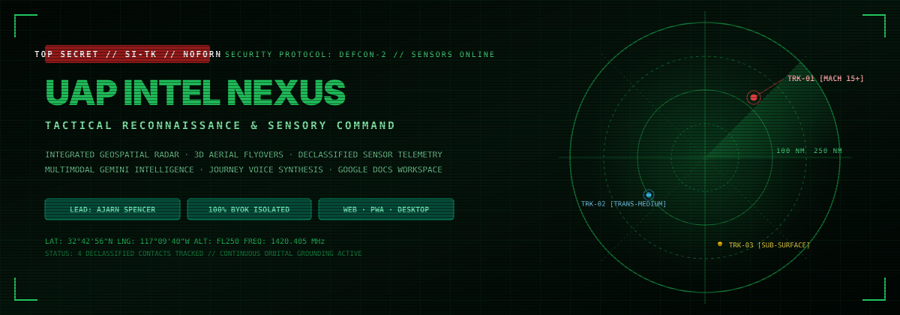

# UAP INTEL NEXUS (UAPHUB) — GLOBAL UAP INTELLIGENCE WORKSTATION

<p align="center">
  
</p>

<p align="center">
  
  
  
  
  
  
  
</p>

---

## 🛰️ EXECUTIVE OVERVIEW

**UAP Intel Nexus** (also known as **UAPHub**) is a specialized tactical aerial phenomena tracking console and intelligence synthesis workstation developed under the direction of **Ajarn Spencer Littlewood**.

Engineered for defense researchers, aerospace analysts, and investigative observers, the workstation replaces slow, brittle web scrapers and unrealistic simulation widgets with a clean, source-aware **Global UAP Discovery Pipeline** powered directly by the Gemini API's official Google Search Grounding engine.

The platform continuously queries international defense ministries, civil aviation authorities, pilot reporting networks, astronomical observatories, and primary eyewitness databases across all geographic sectors and languages—enforcing a strict **rolling 48-hour UTC window** with zero fabrication.

Within each tactical dossier, analysts can synthesize multimodal visual reconstructions (**Nano Banana Pro** photographic surveillance and **KH-11 top-down satellite reconnaissance**), conduct neural audio briefings across multiple Journey voices, access self-contained geolocation coordinates, export classified Google Docs, and compile broadcast-ready **16:9 YouTube MP4 videos with live audio waveforms** in a single click.

---

## 🔐 CLIENT-SIDE BYOK (BRING YOUR OWN KEY) SECURITY GATEWAY

### Strict 100% Client-Side Sandbox (`localStorage`)
To safeguard user privacy and protect sensitive investigative dossiers, UAP Intel Nexus enforces an uncompromising **Bring Your Own Key (BYOK)** architecture:

1. **Zero Server Intermediation**: Your Google Gemini API key and Google Workspace OAuth access tokens reside strictly within your client browser's memory and encrypted local sandbox (`localStorage`). Keys and tokens are **never** transmitted, logged, or proxied through intermediate servers.
2. **Direct Browser-to-API Execution**: All multimodal generative requests (`@google/genai`), Google Search Grounding queries, text intelligence syntheses, and TTS neural voice streams execute directly between your client browser and Google's official endpoints.
3. **Instant Cryptographic Revocation**: Clicking **REVOKE** in the navigation header immediately flushes all stored API keys, tokens, cached dossiers, and active sessions from client storage.
4. **Declassified Historical Archive Mode**: A built-in declassified archive allows immediate exploration of seminal historical incidents (e.g., USS Nimitz FLIR1, Aguadilla CBP, GEIPAN France, Operação Prato Brazil, Rendlesham Forest) without needing immediate external search calls.

👉 **Get Your Official Google AI Studio API Key**:  
[https://aistudio.google.com/app/apikey](https://aistudio.google.com/app/apikey) *(Opens in a new tab; free tier supported).*

---

## ⚡ CORE CAPABILITIES & SYSTEM ARCHITECTURE

```
                      ┌────────────────────────────────────────┐
                      │          UAP INTEL NEXUS WORKSTATION   │
                      └──────────────────┬─────────────────────┘
                                         │
                 ┌───────────────────────┴──────────────────────┐
                 ▼                                              ▼
   ┌───────────────────────────┐                  ┌───────────────────────────┐
   │ GLOBAL UAP DISCOVERY      │                  │ DOSSIER ANALYSIS & EXPORT │
   │ 48-Hour Rolling UTC       │                  │ Workstation Modal Deck    │
   ├───────────────────────────┤                  ├───────────────────────────┤
   │ • Gemini Search Grounding │                  │ • Nano Banana Pro (16:9)  │
   │ • International Registry  │                  │ • KH-11 Satellite Recon   │
   │ • Multilingual Discovery  │                  │ • Neural Voice Briefings  │
   │ • Grounding Citations     │                  │ • Geolocation Telemetry   │
   │ • Deduplication Engine    │                  │ • YouTube 16:9 MP4 Export │
   │ • Observation vs Pub Date │                  │ • Google Docs Sync        │
   └───────────────────────────┘                  └───────────────────────────┘
```

### 1. Global UAP Discovery Pipeline (`services/newsService.ts`)
- **Native Gemini Google Search Grounding**: Implemented using the current `@google/genai` TypeScript SDK with `{ tools: [{ googleSearch: {} }] }`—eliminating all fragile HTML page scraping.
- **Strict Rolling 48-Hour UTC Window**: Automatically calculates dynamic rolling UTC bounds (`[now - 48h] → [now]`). It rejects stale articles, prevents newly indexed historical files from being disguised as recent events, and outputs a strict empty set (`[]`) when no reports meet the cutoff rather than hallucinating incidents.
- **Deduplication & URL Validation**: Normalizes and deduplicates incoming reports across multiple wires by canonical URL, title similarity, and source authority.
- **Programmatic Citation Extraction**: Extracts live grounding chunks (`candidate.groundingMetadata.groundingChunks`) from Google Search results to pair every report with authentic web links.

### 2. Comprehensive International Source Registry
The discovery engine continuously monitors authorized, primary, and corroborating sources across all languages and world regions:
- **North America**: MUFON, NUFORC, AARO.mil (All-Domain Anomaly Resolution Office), NASA UAP Independent Study, The Debrief, FAA, and pilot reporting networks (NARCAP).
- **Europe**: France's GEIPAN (CNES), UK Civil Aviation Authority (CAA), UK Ministry of Defence, European Space Agency (ESA), and established investigative European aviation archives.
- **Latin America**: Brazil's National Archives (*Arquivo Nacional*) & FAB UFO collections (*Operação Prato*), Mexico's civil aviation authority (AFAC / SENEAM), Argentina (CEFORA / Fuerza Aérea), Chile (CEFAA / DGAC), Peru (OIFAA / FAP), and Colombia (FAC).
- **Asia**: Japan Ministry of Defense (MOD) & Parliamentary UAP Caucus, South Korea Ministry of National Defense (MND), India Ministry of Defence & Indian Air Force (IAF) radar tracking corridors.
- **Oceania**: Australia Department of Defence, Royal Australian Air Force (RAAF) historical files, New Zealand National Archives & NZDF files.
- **Africa & Middle East**: Regional civil aviation authorities, national defense ministries, meteorological agencies, and astronomical observatories.

### 3. Source-Aware Categorization & Multilingual Integrity
- **Observation Date vs. Publication Date**: Clearly distinguishes when an anomaly was physically witnessed (`observedAt`) from when the record or declassification was released (`publishedAt`), ensuring historical documents newly published within the 48-hour window are properly identified.
- **Multilingual Headline Preservation**: Captures the authentic native language headline (`originalTitle`) and source language (`originalLanguage`) for non-English sources (French, Japanese, Portuguese, Spanish, etc.) alongside standardized English operational titles.
- **Report Types**: Categorizes dossiers into `Official / Military`, `Aviation / Pilot Network`, `Scientific / Observatory`, `Investigative Media`, and `Eyewitness Database`.
- **Evidence Tiers**: Classifies verification levels into `Primary Official`, `Corroborated Sensor / Radar`, `Aviation Eyewitness`, `Investigative Report`, and `Unverified Civilian`.

### 4. Interactive Workstation & Tactical Filters (`App.tsx`, `components/ArticleCard.tsx`)
- **Telemetry Deck**: Real-time display showing rolling 48h UTC window start and end timestamps, current record count, and grounded search citation totals.
- **Regional Filters**: 1-click filtering across `All Regions`, `North America`, `Europe`, `Latin America`, `Asia`, `Oceania`, and `Africa & Middle East`.
- **Source Type Filters**: Filter by report classification (`Official / Military`, `Aviation / Pilot Network`, `Scientific / Observatory`, etc.).
- **Live Search**: Instant keyword filtering across titles, original foreign headlines, descriptions, geographical sectors, and agency names.
- **Density Control & Pagination**: Configurable display density (9, 18, 27, 45, or 99 dossiers per packet).

### 5. Tactical Incident Geolocation Telemetry (`components/AnalysisModal.tsx`, `services/mapsService.ts`)
- **Self-Contained Sector Telemetry**: Completely eliminates external Google Maps SDK dependencies, third-party trackers, and API billing requirements in favor of a clean, tactical coordinate deck.
- **Precise Coordinates**: Displays latitude and longitude down to 4 decimal places, operational sector names, and terrestrial proximity beacons.
- **Primary Source Intel Links**: Direct one-click access to original source URLs, government documents, and declassified files.
- **Corroborating Web Citations**: Displays clickable grounding citations extracted by Google Search Grounding for immediate source verification.

### 6. Nano Banana Pro Photographic Surveillance Reconstructions (`services/geminiService.ts`)
- **Multi-Tier Generative Cascade**:
  - **Tier 1**: **Nano Banana Pro (`gemini-3-pro-image`)** in 1K 16:9 widescreen format.
  - **Tier 2**: Nano Banana 2 (`gemini-3.1-flash-image`).
  - **Tier 3**: Nano Banana Lite (`gemini-3.1-flash-lite-image`).
  - **Tier 4**: Imagen 3 (`imagen-3.0-generate-002`).
  - **Tier 5**: Procedural Forensic Sensor Simulation Canvas (offline / quota fallback).
- **35mm Optical Surveillance Fidelity**: Renders photorealistic optical camera frames grounded in the incident's specific terrain, time-of-day, weather conditions, and reported vehicle morphology.
- **Direct Export**: 1-click high-resolution PNG image download and instant regeneration.

### 7. Top-Down Satellite Reconnaissance Imagery (`services/geminiService.ts`)
- **Post-Report Terrain & Landmark Extraction**: Analyzes the synthesized intelligence report to identify specific geography, oceanic bathymetry, coastlines, or military installations.
- **NRO KH-11 Orbital Pass Simulation**: Generates top-down orthorectified optical satellite imagery simulating orbital pass sensor captures.
- **Military Telemetry Overlays**: Features simulated ground sample distance (GSD), spectral band tracking, and coordinates.

### 8. Neural Audio Briefings & Voice Synthesis (`services/geminiService.ts`, `utils/audioUtils.ts`)
- **Neural Voice Synthesis**: Powered by Gemini TTS with Journey voice personas (`Fenrir`, `Kore`, `Puck`, `Charon`, `Aoede`, `Zephyr`, `Leda`, `Orus`).
- **Clean RIFF PCM Header Slicing**: Correctly parses RIFF/WAVE chunks to extract raw PCM audio before concatenation, eliminating metallic audio glitches, clicks, pops, or sentence cutoffs.
- **Direct Audio Export**: 1-click download of the complete audio briefing as a `.wav` file.

### 9. YouTube 16:9 MP4 Video Export (`services/videoExportService.ts`)
- **Client-Side Video Synthesis**: Merges the high-resolution Nano Banana Pro photographic still with the neural audio briefing entirely inside the browser using HTML5 Canvas and the MediaRecorder API.
- **Live Oscilloscope HUD**: Renders a dynamic audio waveform responding to voice frequencies, embedded incident GPS coordinates, elapsed time counter, and classification banners.
- **Ready for YouTube Upload**: Produces a standard 16:9 `.mp4` video file ready for instant upload to YouTube, social platforms, or archival repositories.

### 10. Intelligence Export Deck & Google Docs Synchronization (`components/GoogleDocsModal.tsx`)
- **Google Docs Archive Integration**: Authenticates via client-side Google OAuth 2.0 to export structured intelligence reports directly to your Google Drive and Google Docs.
- **Classified PDF Export**: In-browser client-side PDF compilation using `jspdf`, formatted with declassified headers, incident telemetry, and embedded visual imagery.
- **Raw Markdown Export**: 1-click clipboard copy and `.md` file download.

---

## 🛠️ TECH STACK

| Layer | Technology | Purpose |
| :--- | :--- | :--- |
| **Frontend Framework** | React 19 + TypeScript 5.8 | Reactive component tree, custom hooks, and strict type safety |
| **Build System** | Vite 6.2 | Near-instant HMR, ES module bundling, and optimized production builds |
| **Styling & Design System** | Tailwind CSS v4 | High-contrast tactical cyber aesthetic with zero-pill typography |
| **Discovery Pipeline** | `@google/genai` (Gemini SDK) | Google Search Grounding with rolling 48-hour UTC parameters |
| **Text Intelligence** | `gemini-3.8-flash` / `gemini-flash-latest` | Multilingual synthesis, classification, and reporting |
| **Photographic Recon** | Nano Banana Pro (`gemini-3-pro-image`) | 1K 16:9 photorealistic 35mm optical surveillance reconstructions |
| **Satellite Imagery** | Nano Banana Pro / Imagen 3 | Orthorectified top-down KH-11 orbital pass simulation |
| **Speech & Audio** | Gemini TTS + Journey Voices | Neural verbal briefings with clean RIFF PCM header parsing |
| **Video Production** | Canvas API + Web Audio + MediaRecorder | In-browser 16:9 MP4 video compilation with real-time waveform HUD |
| **Document Export** | jsPDF + Google Docs OAuth 2.0 | Classified PDF compilation and 1-click Google Drive synchronization |
| **Security Architecture** | 100% Client-Side BYOK | `localStorage` sandbox, zero server logging, zero key transmission |

---

## 💻 LOCAL DEVELOPMENT SETUP

```bash
# 1. Clone the repository
git clone https://github.com/ajarnspencer/uap-intel-nexus.git
cd uap-intel-nexus

# 2. Install dependencies
npm install

# 3. Start local development server on port 3000
npm run dev

# 4. Verify TypeScript and production build
npm run lint
npm run build
```

---

## 🧭 PROJECT SCRIPTS

| Command | Action |
| :--- | :--- |
| `npm run dev` | Starts Vite development server at `http://localhost:3000` |
| `npm run build` | Compiles production TypeScript bundle into `dist/` |
| `npm run lint` | Runs `tsc --noEmit` to validate all TypeScript types |
| `npm run preview` | Previews the compiled production build locally |

---

## 📜 LEADERSHIP & ATTRIBUTION

- **Project Lead & Architecture**: Ajarn Spencer Littlewood
- **Platform**: UAP Intel Nexus (UAPHub)
- **Security Paradigm**: 100% Client-Side BYOK Isolation
- **License**: MIT Open Source
